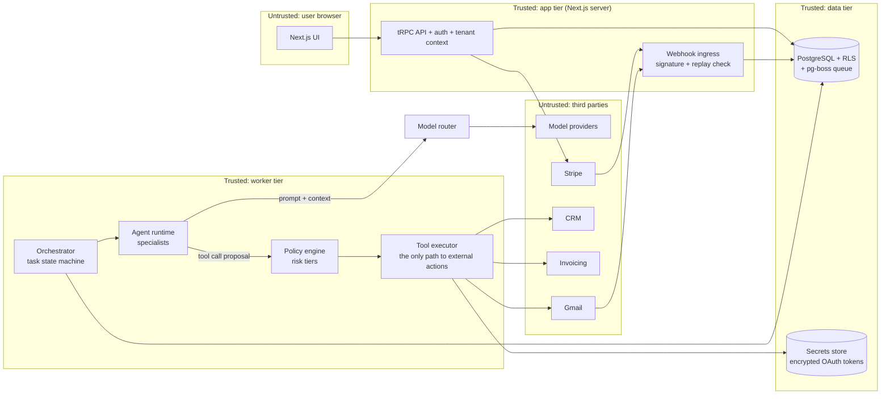
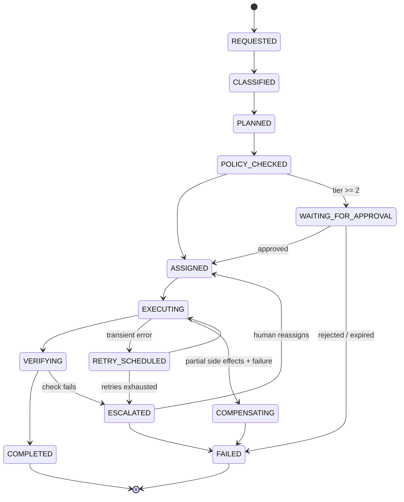

# Architecture v1 — Workforce OS (PROPOSAL, awaiting approval)

Status: draft from Session 1. Nothing here is built. Decisions marked **DECISION** need owner sign-off at the gate.

## 1. Components and trust boundaries

Key rule: **agents propose, the executor acts.** An agent never holds credentials and never calls a third party directly. The tool executor reads the tool's declared risk tier, asks the policy engine, and either runs it, or creates an approval request and stops.

Everything a model returns is untrusted input, including tool arguments.

## 2. Tenancy and RLS strategy

- Tenant key is `tenant_id` = `organizations.id`. Every tenant-scoped table carries it, `NOT NULL`, indexed first in composite keys.
- Postgres RLS on every tenant table with `ENABLE` **and** `FORCE ROW LEVEL SECURITY`. Policy: `tenant_id = current_setting('app.tenant_id')::uuid`.
- The app connects as role `app_user`, which has no `BYPASSRLS` and does not own the tables. Migrations run as a separate owner role.
- Each request or job opens a transaction and runs `SET LOCAL app.tenant_id = $1` through one helper, `withTenant(tenantId, fn)`. Code outside that helper cannot get a connection (lint rule + review).
- Child rows reference parents with composite foreign keys `(tenant_id, parent_id)`, so a row cannot point at another tenant's record even by bug.
- Workers resolve tenant from the job payload, then re-check that the task row exists under that tenant before acting.
- Proof: Milestone 1 ships a test that seeds tenants A and B and asserts every endpoint and table returns zero B rows to A, including raw SQL as `app_user`.

## 3. Data model (approved table list)

`T` = tenant-scoped with RLS. `G` = global.

| Table | Scope | Key columns and notes |
|---|---|---|
| users | G | id, email (unique), name, auth fields. Only rows visible are self + co-members (via view). |
| organizations | G (row = tenant) | id, name, plan, status. RLS: visible if member. |
| organization_members | T | (tenant_id, user_id), role: owner/admin/member/viewer |
| subscriptions | T | stripe_customer_id, stripe_subscription_id, status, period_end |
| usage_events | T | id, agent_id, task_id, kind (model_tokens/tool_call), quantity, cost_micros, idempotency_key unique |
| agents | T | id, kind (orchestrator/inbox/sales/finance/scheduling/reporting), display_name, status, current_version_id |
| agent_versions | T | id, agent_id, model_policy, instructions, tool_allowlist, created_by. Immutable. |
| agent_permissions | T | agent_id, tool_name, integration_connection_id, max_tier. Least privilege per agent. |
| tasks | T | id, parent_task_id, requested_by, assigned_agent_id, state, version (optimistic lock), input, result, error, deadline |
| task_dependencies | T | (tenant_id, task_id, depends_on_task_id) |
| workflow_executions | T | id, task_id, step, attempt, status, started_at, finished_at, output_ref. Step-level history. |
| approval_requests | T | id, task_id, tier, action_digest (sha256 of exact tool+args), payload, status, requested_at, expires_at, decided_by, decided_at, consumed_at |
| integration_connections | T | id, provider, account_label, scopes, secret_ref (pointer, never the token), status |
| email_identities | T | id, integration_connection_id, address, mode (draft_only/send_with_approval) |
| conversations | T | id, channel, subject, external_thread_id |
| messages | T | id, conversation_id, direction, sender, body_ref, external_id unique per tenant |
| contacts | T | id, name, email, phone, source |
| crm_records | T | id, contact_id, provider, external_id, stage, amount_cents, synced_at |
| invoices | T | id, contact_id, provider, external_id, status, amount_cents, due_date |
| memory_records | T | id, layer (working/org), scope_ref, content, source_ref, created_by_agent, trust (user/verified/agent) |
| audit_events | T | id, actor_type (user/agent/system), actor_id, action, target, tier, approval_request_id, idempotency_key, outcome, at. Append-only: `app_user` has INSERT only. |
| billing_ledger | T | id, entry_type, amount_micros, stripe_ref, period. Append-only. |

Full column-level schema lands in `docs/design/schema.md` during Milestone 1.

## 4. Task lifecycle state machine

Persistence semantics:
- `tasks.state` changes only through one function, `transition(taskId, from, to)`, which does `UPDATE ... WHERE state = from AND version = n` and bumps `version`. Zero rows updated means someone else moved it; the caller re-reads.
- Each transition writes an `audit_events` row in the same transaction.
- Side effects run only in `EXECUTING`, inside a `workflow_executions` step keyed by `(task_id, step, attempt)`. External calls carry an idempotency key derived from that key, so a re-run after a worker crash does not double-send.
- A step that might have reached the provider before the crash is reconciled (look up by idempotency key) before retry.
- Approval does not skip policy: when an approval resumes a task, the executor recomputes the action digest and refuses if it differs from the approved one.

## 5. Orchestration — DECISION

See `orchestration-adr.md`. Proposal: **pg-boss on the same Postgres for the MVP**, Temporal as a later upgrade.

## 6. Computer use — DEFERRED

See `computer-use-adr.md`. MVP defines the interface only; no provider is integrated.

## 7. Threat model

| Threat | Mitigation | Enforced where |
|---|---|---|
| Prompt injection (email body, CRM note, web page tells the agent to act) | Tool calls are proposals; the executor checks tier and agent permissions regardless of what the model says. Tier 2+ always needs a human. External content is wrapped and labelled as data in prompts. Agents can't add recipients the task didn't name without a fresh approval. | `executor/policy.ts`, `agents/context.ts` |
| Cross-tenant leakage | RLS with FORCE, non-owner app role, `withTenant` helper only, composite FKs, isolation test per endpoint. Memory and retrieval queries run inside the same tenant transaction. | Postgres policies, `db/withTenant.ts`, CI test suite |
| Credential exfiltration | OAuth tokens encrypted at rest (envelope encryption, key outside DB), referenced by `secret_ref`, decrypted only inside the executor for one call. Never placed in prompts, logs or tool results. Log redaction for token patterns. Per-connection scopes, least privilege. | `executor/secrets.ts`, logger redaction config |
| Webhook replay / forgery | Verify provider signatures (Stripe, Google push), reject timestamps outside 5 minutes, store event IDs with a unique constraint and drop duplicates. | `app/api/webhooks/*`, unique index |
| Memory poisoning | Each memory record carries source and trust level. Agent-written memory is `agent` trust and can't change policy, permissions or contacts' payment details. Org-layer memory written only from user input or approved tasks. User can view and delete memory. | `memory/write.ts`, policy engine |
| Approval replay / swap | Approval bound to `action_digest`, single-use (`consumed_at`), expires (default 24 h), tenant-scoped, and decided only by a member with the right role. Executor re-hashes before acting. Tier 4 needs a second confirmation by a fresh request. | `executor/approvals.ts`, DB unique + check constraints |
| Runaway spend | Per-tenant and per-task budget caps checked before each model call; usage_events written per call; hard stop at cap. | `router/budget.ts` |

## 8. Proposed verified commands (to be approved, then written into CLAUDE.md)

- Install: `pnpm install`
- Test: `pnpm test` (Vitest, needs a Postgres reachable at `DATABASE_URL`)
- Lint/typecheck: `pnpm lint && pnpm typecheck`
- Build: `pnpm build`

## 9. Implementation notes (Sessions 2–3)

Status: architecture approved by the owner ("move to phase 2") and implemented through Milestone 8. Differences from the proposal above:

- **Extra tables** beyond the approved list: `auth_sessions`, `auth_accounts`, `auth_verifications` (auth library, ADR-003) and `webhook_events` (global replay protection for Stripe). All hold no tenant data.
- **Credentials** live in `integration_connections.secret_ciphertext` (AES-256-GCM, key outside the DB, additional data binds each ciphertext to its tenant and connection) rather than a separate secrets service. Revisit if a managed KMS is adopted.
- **Direct plans**: server code can create a task with a fixed action list (e.g. "send this draft"). It skips the model but still passes policy and approval. Not reachable through the public task API.
- **Reply recipients are derived from the thread**, never from model output, and the approved email content must still match at send time.
- **Memory**: agent-written notes stay in the task's working layer; org-layer memory needs a person (typed in, or an agent proposal approved at tier 2). A DB check forbids org memory with agent trust.
- **Metering** hooks wrap every model call; the budget check runs before the call.
- **Planning is single-shot** (see readiness report, gap 5).
- **Queue maintenance** runs in the worker (`WOS_QUEUE_SUPERVISE`), which re-queues jobs held by a crashed worker after `expireInSeconds` (300).
